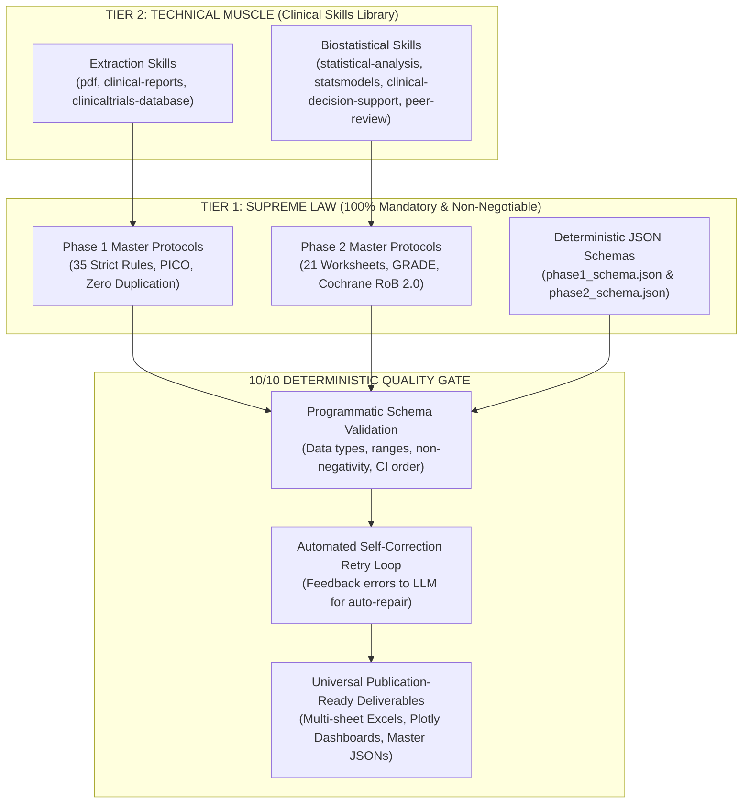

# M Λ N D O R O S
### Meta-Analysis Network for Data, Outcomes & Research Optimization Synthesis
*— From Raw Trials to Global Clinical Verdicts. —*  
*— S M A R T E R &nbsp; E V I D E N C E . &nbsp; B E T T E R &nbsp; D E C I S I O N S . —*

[](https://mandoros.onrender.com)
[](https://github.com/ahmedmando133/MANDOROS)
[](https://mandoros.onrender.com)

> 🌐 **Live Cloud Production URL:** [https://mandoros.onrender.com](https://mandoros.onrender.com)

---

## 🌟 Executive Overview
**MANDOROS** is a next-generation clinical trial extraction, meta-analysis, and predictive analytics engine. It transforms raw clinical trial protocols and published RCT PDFs into standardized, audit-verified evidence databases compliant with Cochrane, PRISMA, and top-tier academic biostatistical standards. Accessible locally or worldwide at [https://mandoros.onrender.com](https://mandoros.onrender.com).

---

## 🧬 The 8-Node MANDOROS Pipeline

| Node | Acronym | Keyword | Mission |
| :---: | :---: | :--- | :--- |
| 📄 | **M** | **Meta-Analysis** | Combine evidence from multiple clinical studies using fixed and random-effects models. |
| 🧠 | **A** | **AI & Automation** | Extract, process, and structure complex protocols with multi-stage intelligence. |
| 🕸️ | **N** | **Network** | Connect trials, active ingredients, and indirect treatment comparisons (NMA). |
| 🗄️ | **D** | **Data** | From unstructured PDFs to clean, audit-traceable, tabular datasets. |
| 🎯 | **O** | **Outcomes** | Track clinical results, biomarkers, endpoints, and efficacy/safety signals. |
| 📑 | **R** | **Research** | Focus on randomized controlled trials (RCTs) and real-world evidence. |
| ⚙️ | **O** | **Optimization** | Standardize, harmonize units, and enforce zero-hallucination data quality. |
| 📈 | **S** | **Synthesis** | Build cross-trial insights, meta-regression models, and virtual trial predictions. |

---

## 🏛️ Two-Phase Architecture & Master Protocol Governance

MANDOROS enforces a strict, bi-level **Hierarchy of Authority** across all extraction and evidence synthesis pipelines:



### 1. Phase 1: Strict Single-RCT Clinical Extraction Pipeline
- **Master Extraction Rules (35 Non-Negotiable Directives):** Enforces zero data duplication, verbatim quote provenance linking, and cell-level data normalization.
- **PICO & CONSORT Alignment:** Standardizes population, intervention, comparator, and outcome mappings with mathematical verification of all arm sample sizes ($N$).
- **Atomic Eligibility Thresholds:** Parses continuous and categorical inclusion/exclusion criteria into isolated mathematical operators (`min_operator`, `min_value`, `max_operator`, `max_value`, `unit`).
- **Zero Hallucination Guarantee:** The original research publication PDF is the absolute ground truth; zero imputation or assumption is permitted.

### 2. Phase 2: Multi-Trial Cohort Meta-Analysis & Evidence Synthesis
- **21-Worksheet Relational Architecture:** Builds full Master Extraction Sheet, Study Characteristics, Treatment Arms, Eligibility Criteria, Baseline Population, Efficacy & Safety Endpoints, PICO Compatibility, and Quantitative Synthesis matrices.
- **metafor-Grade Biostatistical Models:** Inverse-Variance Fixed-Effect, DerSimonian-Laird (DL), and Restricted Maximum Likelihood (REML) random-effects pooling with Knapp-Hartung adjustments.
- **Heterogeneity & Predictive Uncertainty:** Exact computations of Cochran's $Q$, $p$-value, $I^2$ (%), $\tau^2$, and **95% Prediction Intervals (PI)**.
- **Cochrane Risk of Bias 2.0:** Evaluates study bias across all 5 domains ($D1$ Randomization, $D2$ Deviations, $D3$ Missing Data, $D4$ Measurement, $D5$ Selection) and overall bias rating.
- **GRADE Evidence Profiles:** Formal evaluation of evidence certainty across 5 downgrade (RoB, Inconsistency, Indirectness, Imprecision, Publication Bias) and 3 upgrade criteria.
- **100/100 Academic Quality Score:** Strict scoring across 12 institutional validation domains ensuring submission readiness for top medical journals (*The Lancet*, *NEJM*, *JAMA*).

### 3. Hard Programmatic Quality Gate & Self-Correction Retry Loop
- **Programmatic Validation:** Every payload is validated against strict JSON schemas before being exposed to users or downstream consumers.
- **Self-Correction Feedback:** If any schema key, numeric bound ($I^2 \in [0, 100]$, $\tau^2 \ge 0$, $\text{CI lower} \le \text{CI upper}$, $\text{ratio} > 0$), or rule fails, the exact diagnostic diff is fed back into the LLM in an automated retry loop.
- **Local === Render Cloud Parity:** 100% path-agnostic design dynamically resolves bundled protocols and skills on both Windows local environments and Linux Render cloud production.

---

## 🚀 Quick Start & Launchers

### 🌐 Live Cloud Web Application (Production)
Access the live production instance deployed on Render with zero setup:
- **URL:** [https://mandoros.onrender.com](https://mandoros.onrender.com)
- Continuous deployment directly from GitHub `main`.
- Upload trial PDFs, extract structured workbooks, pool cross-trial cohorts, and simulate predictive virtual trials directly in the browser.

### 💻 Local Web Interface
Double-click `Run_MANDOROS_Web_App.bat` or run:
```bash
python app.py
```
Access the Apple-styled dark UI at: `http://localhost:7860`

### Running Batch Extraction (Stage-1)
Double-click `Run_MANDOROS_Extraction.bat` or run:
```bash
python -m src.main --all
```

### Running Cohort Meta-Analysis (Phase-2)
Double-click `Run_MANDOROS_Cohort_Analysis.bat` or run:
```bash
python run.py analyze-cohort --cohort Mixed_Metabolic_Cohort
```

---

## 📦 Deliverables Produced

1. **Master Comparison & Meta-Analysis Excel (`.xlsx`):**
   - `<Cohort_Name>_MANDOROS_Master_Report.xlsx` (10 multi-level sheets, including `In_Silico_New_Discoveries` and `Synthesized_Virtual_Trial`).
2. **Interactive Executive Dashboard (`.html`):**
   - `<Cohort_Name>_MANDOROS_Executive_Dashboard.html` (Standalone Plotly charts, in-silico emergent discoveries, SUCRA rankings, heatmaps).
3. **Stage-1 Individual Trial Excels Bundle (`.zip`):**
   - `<Cohort_Name>_Individual_Stage1_Trial_Excels.zip`.
4. **Individual Trial Excels (`.xlsx`):**
   - `<study_id>_structured_extracted.xlsx` (in `outputs/` and `extracted_trials/`).

---

## 🔒 Security & Data Integrity
- Single source of truth in `src/canonical.py`.
- Zero-hallucination policy (`not_reported` for unmeasured data).
- Strict separation of numeric values, operators, and units.
- Full PRISMA, Cochrane, and academic systematic review compatibility.
