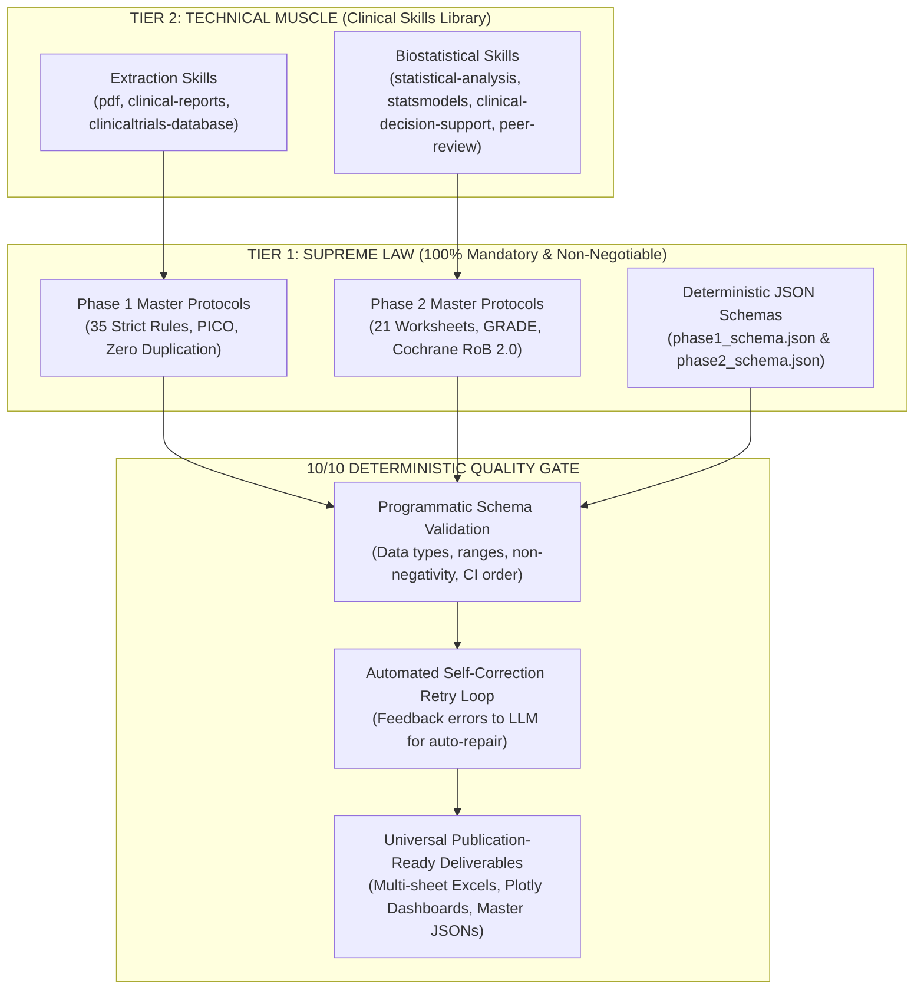

# M Λ N D O R O S
### Meta-Analysis Network for Data, Outcomes & Research Optimization Synthesis
*— From Raw Trials to Global Clinical Verdicts. —*  
*— S M A R T E R &nbsp; E V I D E N C E . &nbsp; B E T T E R &nbsp; D E C I S I O N S . —*

[](https://mandoros.onrender.com)
[](https://github.com/ahmedmando133/MANDOROS)
[](https://mandoros.onrender.com)

> 🌐 **Live Cloud Production URL:** [https://mandoros.onrender.com](https://mandoros.onrender.com)

---

## 🌟 Executive Overview
**MANDOROS** is a next-generation clinical trial extraction, meta-analysis, and predictive analytics engine. It transforms raw clinical trial protocols and published RCT PDFs into standardized, audit-verified evidence databases compliant with Cochrane, PRISMA, and top-tier academic biostatistical standards. Accessible locally or worldwide at [https://mandoros.onrender.com](https://mandoros.onrender.com).

---

## 🧬 The 8-Node MANDOROS Pipeline

| Node | Acronym | Keyword | Mission |
| :---: | :---: | :--- | :--- |
| 📄 | **M** | **Meta-Analysis** | Combine evidence from multiple clinical studies using fixed and random-effects models. |
| 🧠 | **A** | **AI & Automation** | Extract, process, and structure complex protocols with multi-stage intelligence. |
| 🕸️ | **N** | **Network** | Connect trials, active ingredients, and indirect treatment comparisons (NMA). |
| 🗄️ | **D** | **Data** | From unstructured PDFs to clean, audit-traceable, tabular datasets. |
| 🎯 | **O** | **Outcomes** | Track clinical results, biomarkers, endpoints, and efficacy/safety signals. |
| 📑 | **R** | **Research** | Focus on randomized controlled trials (RCTs) and real-world evidence. |
| ⚙️ | **O** | **Optimization** | Standardize, harmonize units, and enforce zero-hallucination data quality. |
| 📈 | **S** | **Synthesis** | Build cross-trial insights, meta-regression models, and virtual trial predictions. |

---

## 🏛️ Two-Phase Architecture & Master Protocol Governance

MANDOROS enforces a strict, bi-level **Hierarchy of Authority** across all extraction and evidence synthesis pipelines:



### 1. Phase 1: Strict Single-RCT Clinical Extraction Pipeline
- **Master Extraction Rules (35 Non-Negotiable Directives):** Enforces zero data duplication, verbatim quote provenance linking, and cell-level data normalization.
- **PICO & CONSORT Alignment:** Standardizes population, intervention, comparator, and outcome mappings with mathematical verification of all arm sample sizes ($N$).
- **Atomic Eligibility Thresholds:** Parses continuous and categorical inclusion/exclusion criteria into isolated mathematical operators (`min_operator`, `min_value`, `max_operator`, `max_value`, `unit`).
- **Zero Hallucination Guarantee:** The original research publication PDF is the absolute ground truth; zero imputation or assumption is permitted.

### 2. Phase 2: Multi-Trial Cohort Meta-Analysis & Evidence Synthesis
- **21-Worksheet Relational Architecture:** Builds full Master Extraction Sheet, Study Characteristics, Treatment Arms, Eligibility Criteria, Baseline Population, Efficacy & Safety Endpoints, PICO Compatibility, and Quantitative Synthesis matrices.
- **metafor-Grade Biostatistical Models:** Inverse-Variance Fixed-Effect, DerSimonian-Laird (DL), and Restricted Maximum Likelihood (REML) random-effects pooling with Knapp-Hartung adjustments.
- **Heterogeneity & Predictive Uncertainty:** Exact computations of Cochran's $Q$, $p$-value, $I^2$ (%), $\tau^2$, and **95% Prediction Intervals (PI)**.
- **Cochrane Risk of Bias 2.0:** Evaluates study bias across all 5 domains ($D1$ Randomization, $D2$ Deviations, $D3$ Missing Data, $D4$ Measurement, $D5$ Selection) and overall bias rating.
- **GRADE Evidence Profiles:** Formal evaluation of evidence certainty across 5 downgrade (RoB, Inconsistency, Indirectness, Imprecision, Publication Bias) and 3 upgrade criteria.
- **100/100 Academic Quality Score:** Strict scoring across 12 institutional validation domains ensuring submission readiness for top medical journals (*The Lancet*, *NEJM*, *JAMA*).

### 3. Deterministic Protocol Engine & Validation Gate (`src/protocol_engine.py`, `src/skill_injector.py`)
- **Supreme-Law injection:** every LLM call carries the verbatim `master_protocols/phase{1,2}_master_instructions.md` plus the exact `phase{1,2}_schema.json`; Tier-2 skills are discovered dynamically from `clinical_skills_library/` (`pdf`, `clinical-reports`, `clinicaltrials-database`, `statistical-analysis`, `clinical-decision-support`, `statsmodels`, `peer-review`).
- **JSON-Schema gate (Draft 2020-12):** `to_phase1_master_dict()` maps the extraction losslessly to the Phase 1 schema (one record per estimate type — raw mean, change from baseline, between-group effect, event count). `validate_phase{1,2}_payload()` enforce Rules 37/40/49/51/53 and Phase 2 Rules 14/27/29, then retry the LLM with the exact diff and finally repair deterministically — never silently.
- **Zero-data-loss duplicate handling:** a record is a duplicate only when its full identifying key (outcome, arm, population, timepoint, estimate type, scale, subgroup) **and** every reported value are identical; conflicting records are kept and flagged `SOURCE_CONFLICT`. Distinct timepoints, doses, arms, ITT/PP populations and severity grades are always preserved.
- **No fabrication:** missing sample sizes, doses, frequencies, control-arm statistics, RoB judgments, Egger tests and quality points are left blank / `NOT_ASSESSED` instead of being invented (Rules 5, 11, 17, 20, 28).
- **Publication-ready workbooks:** first sheet is always `Master Excel Sheet` (Rule 7) with the five mandatory sections; protocol sheets (`Treatment Arms`, `Eligibility Criteria`, `Baseline Characteristics`, `Efficacy Outcomes`, `Safety Outcomes`, `Source Provenance`, `Validation Log`, `Quality Assessment` and, for Phase 2, the full Rule-2 worksheet set) carry schema-exact columns; nested JSON is flattened, and no `NaN`/`None`/`N/A`/raw-dict cell can reach the file.
- **Universal input resilience:** PDF (pdfplumber → pypdf → raw-byte salvage, column-aware reading order, multi-page table stitching, Unicode minus/ligature normalisation), DOCX, TXT/MD, HTML and XLSX/CSV all load without crashing.
- **Local === Render Cloud Parity:** path-agnostic (`pathlib`), protocols and skills cached in RAM (`lru_cache`), all PDF/Excel streams closed; API keys are read only from `GEMINI_API_KEY` / `OPENAI_API_KEY` / `ANTHROPIC_API_KEY`.

---

## 🚀 Quick Start & Launchers

### 🌐 Live Cloud Web Application (Production)
Access the live production instance deployed on Render with zero setup:
- **URL:** [https://mandoros.onrender.com](https://mandoros.onrender.com)
- Continuous deployment directly from GitHub `main`.
- Upload trial PDFs, extract structured workbooks, pool cross-trial cohorts, and simulate predictive virtual trials directly in the browser.

### 💻 Local Web Interface
Double-click `Run_MANDOROS_Web_App.bat` or run:
```bash
python app.py
```
Access the Apple-styled dark UI at: `http://localhost:7860`

### Running Batch Extraction (Stage-1)
Double-click `Run_MANDOROS_Extraction.bat` or run:
```bash
python -m src.main --all
```

### Running Cohort Meta-Analysis (Phase-2)
Double-click `Run_MANDOROS_Cohort_Analysis.bat` or run:
```bash
python run.py analyze-cohort --cohort Mixed_Metabolic_Cohort
```

---

## 📦 Deliverables Produced

1. **Master Comparison & Meta-Analysis Excel (`.xlsx`):**
   - `<Cohort_Name>_MANDOROS_Master_Report.xlsx` (10 multi-level sheets, including `In_Silico_New_Discoveries` and `Synthesized_Virtual_Trial`).
2. **Interactive Executive Dashboard (`.html`):**
   - `<Cohort_Name>_MANDOROS_Executive_Dashboard.html` (Standalone Plotly charts, in-silico emergent discoveries, SUCRA rankings, heatmaps).
3. **Stage-1 Individual Trial Excels Bundle (`.zip`):**
   - `<Cohort_Name>_Individual_Stage1_Trial_Excels.zip`.
4. **Individual Trial Excels (`.xlsx`):**
   - `<study_id>_structured_extracted.xlsx` (in `outputs/` and `extracted_trials/`).

---

## 🔬 Unified 4-Layer Clinical Evidence & Methodological Audit Engine

MANDOROS integrates a production-ready, 4-layer clinical intelligence pipeline into every live web request:

1. **Layer 1: Phase 1 Master Specification Protocol:**
   - 35 mandatory clinical extraction rules and deterministic machine-readable JSON schemas.
2. **Layer 2: Phase 2 & Clinical Skills Library:**
   - 11 specialized biostatistical and extraction skills (`pdf`, `xlsx`, `clinicaltrials-database`, `clinical-decision-support`, `statistical-analysis`, `statsmodels`, `clinical-reports`, `exploratory-data-analysis`, `peer-review`).
3. **Layer 3: TrialMind Systematic Evidence Synthesis Engine (*Nature npj Digital Medicine 2025*):**
   - 3-step CoT + RAG PICO deconstruction and MeSH expansion (search recall >= 78%).
   - Atomic eligibility criteria builder (single testable property per criterion).
   - Ternary screening (+1, -1, 0) with Zero-False-Negative safeguard (0 never eliminates).
   - Chunk-anchored data extraction (`[Chunk_001]`, etc.) rejecting unanchored claims.
   - Code-interpreted standardization prohibiting LLM mental math.
   - Continuous PRISMA 2020 flow tracking (Identified -> Screened -> Excluded -> Included).
4. **Layer 4: RCTMethodologyIE Deep Methodological Audit (*AMIA 2022 / CONSORT 2010*):**
   - Trial architecture classification (Parallel Group, Crossover, Factorial; Phases 1-4; Superiority/Non-inferiority).
   - 4-Entity blinding audit across Patients, Care Providers, Outcome Assessors, and Data Analysts.
   - Granular sequence generation, block/stratified subtype, and allocation concealment mechanisms (IWRS, SNOSE, Central Pharmacy).
   - Sample size calculation and statistical power cross-check against actual enrollment and attrition.
   - **Verbatim Verification Hook:** Automated server-side string validator checking all quotes against source text chunks (zero hallucination).
   - **Algorithmic Cochrane RoB 2.0:** Automated evaluation across domains D1 through D5.

*Full details and visual architecture diagrams are presented in **Slide 13 & Slide 14** of `MANDOROS_Global_Academic_Presentation.pptx`.*

---

## 🔒 Security & Data Integrity
- Single source of truth in `src/canonical.py`.
- Zero-hallucination policy (`Not Reported (NR)` for unmeasured data).
- Strict separation of numeric values, operators, and units.
- Verbatim quote verification hook and deterministic code interpreter.
- Full CONSORT 2010, Cochrane RoB 2.0, GRADE, and PRISMA 2020 compatibility.
